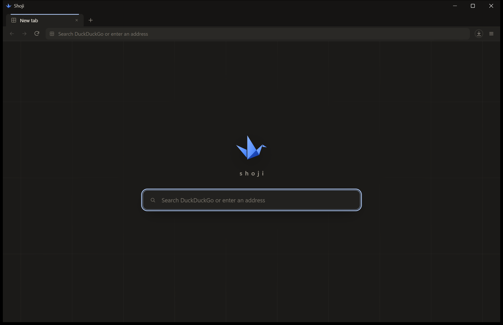
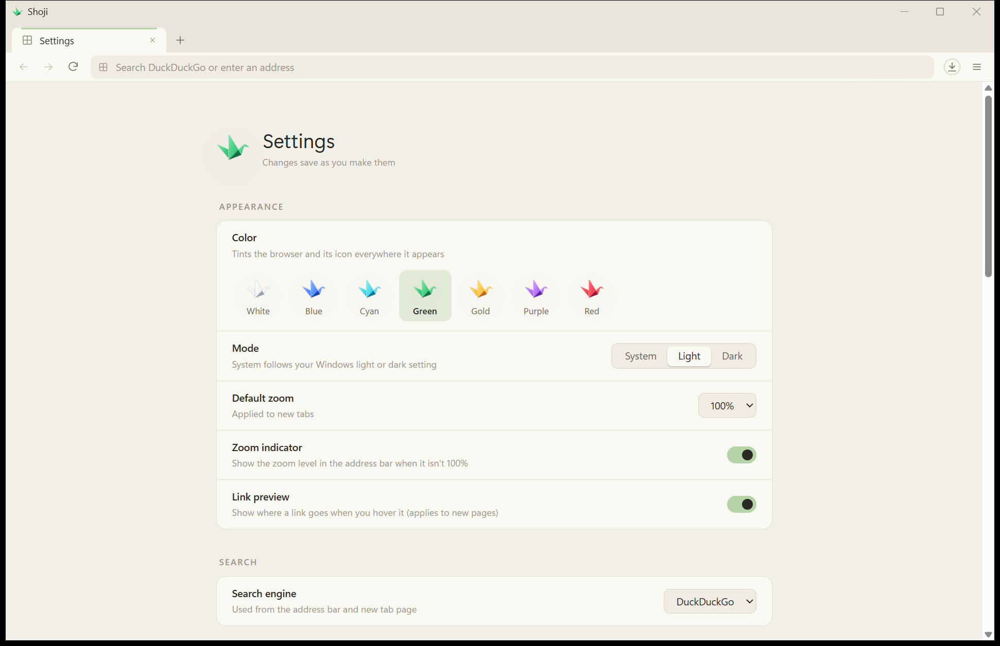
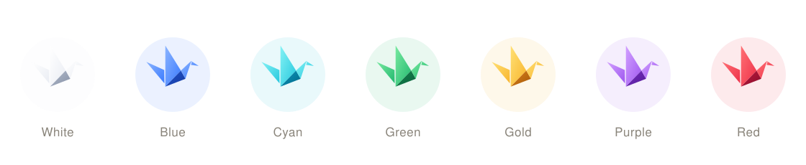
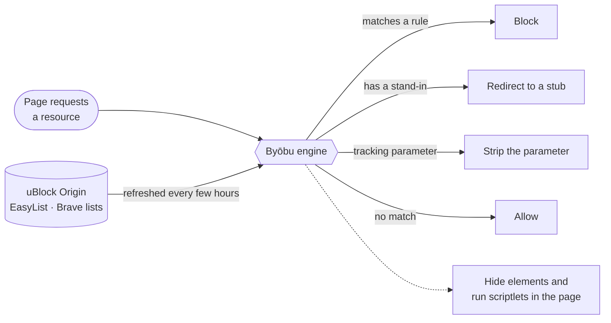
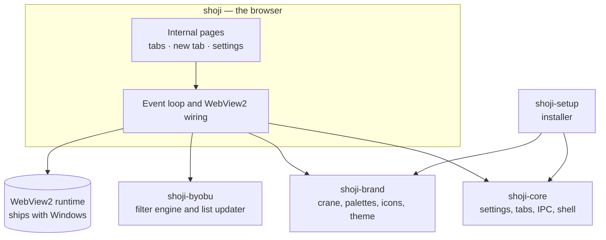

<div align="center">

<picture>
  <source media="(prefers-color-scheme: dark)" srcset="docs/assets/banner-dark.svg">
  
</picture>

<br>

[](../../releases/latest)
[](../../actions/workflows/ci.yml)


[](LICENSE)

**障子** · A small Rust shell around the WebView2 engine Windows already keeps up to date.<br>
Quiet, private when you want it, and light enough to forget it's running.

[Download](../../releases/latest) · [Features](#features) · [Byōbu shield](#byōbu-the-shield) · [Build](#build) · [Architecture](docs/architecture.md)

</div>

<br>

<p align="center">
  
  
</p>

## The idea

A *shoji* is the sliding paper screen of a Japanese room: a thin frame that lets light through
and keeps very little for itself. Shoji the browser works the same way. It doesn't ship a
browser engine. It uses the Microsoft Edge WebView2 runtime that Windows 10 and 11 already
install and patch, and adds only what a browser needs around it — tabs, an address bar, a
side panel, settings — drawn in a calm paper-and-ink interface.

|  |  |
| :-- | :-- |
| **Small** | A ~6 MB executable, fonts and ad shield included. No bundled engine, no updater service. |
| **Quiet** | No account, no sync server, no telemetry. Favicons come from the pages themselves. |
| **Private on request** | Remembers like a normal browser by default; one switch makes every tab live in memory only. |
| **Light** | Background tabs drop to low memory priority at once and are suspended after a few idle minutes. |

## Features

### Look and feel

<p align="center">
  
</p>

- **Seven cranes.** Pick a colour on first launch. The interface takes a soft pastel tint, and the
  icon in the title bar, taskbar, Start menu and desktop follows. Change it any time in Settings.
- **Washi and Sumi.** A warm paper theme for light mode and an ink theme for dark, following
  Windows or set by hand.
- **Three sets of type.** *Shinbun* (Newsreader over Instrument Sans), *Kinari* (soft Fraunces
  over Literata) or *Hon* (Literata throughout). First-run setup lets you try each before choosing.
- **Tabs in the title bar.** Native shadow, snapping and resize edges stay; the caption goes.

### Browsing

- **Dark websites.** One moon button darkens every site (built on a modified
  [Dark Reader](https://github.com/darkreader/darkreader)), leaves pages that already have a dark
  theme alone, and remembers sites you'd rather see in their own colours.
- **Reader view, split view and tab groups.** Read an article without the chrome, put two pages
  side by side, and keep related tabs together.
- **Favourites and a command palette.** `Ctrl+K` jumps to tabs, pages and actions.
- **Session restore, HTTPS-only mode and per-site zoom.**
- **Quick notes.** The notepad button unfolds a sheet of ruled paper in the corner; just start
  typing. Pages are kept locally as a small diary.
- **Tear-off tabs.** Drag a tab out of the window and the live page moves as it is, without
  reloading.

### Privacy

- Logins, cookies, cache and history live in your Windows profile and are encrypted by the engine
  with your Windows credentials. Choose **Private mode** and everything stays in memory and
  vanishes when you close the window; sites you pick can still keep you signed in.
- No telemetry. Apart from the pages you open, Shoji's own requests are filter-list refreshes and,
  while search suggestions are on, your chosen search engine's suggestions as you type.

## Byōbu, the shield

**Byōbu** (屏風, a folding screen) is Shoji's built-in ad and tracker blocker. It uses Brave's
open-source [`adblock`](https://github.com/brave/adblock-rust) matcher with uBlock Origin and
Brave filter lists, fetched at runtime and refreshed in the background — nothing to install, and
nothing to keep up to date by hand.



- **Toolbar shield** with a live count for the page, struck through when paused on that site.
- **Side panel:** this page's blocks, a per-site switch, **Hide an element…** (point at it and
  it's gone), the request log, and settings.
- **Modes:** off, standard or aggressive. Add your own lists by URL, or write your own rules in
  uBlock syntax.
- **Request log** shows what was acted on and which filter matched, so a broken page is a quick
  fix instead of a mystery.

## Install

Download **`ShojiSetup.exe`** from the [latest release](../../releases/latest). It installs for
your user only into `%LOCALAPPDATA%\Programs\Shoji` — no administrator prompt — adds Start menu
and desktop shortcuts, and registers an uninstaller under *Settings → Apps*.

> Shoji isn't code-signed yet, so SmartScreen may say the app is unrecognized. Choose
> **More info → Run anyway**.

Requires Windows 10 or 11 and the
[WebView2 runtime](https://developer.microsoft.com/microsoft-edge/webview2/), which current
versions of Windows already include.

## Shortcuts

| | |
| --- | --- |
| New tab / window | `Ctrl+T` / `Ctrl+N` |
| Reopen closed tab | `Ctrl+Shift+T` |
| Close tab | `Ctrl+W` or middle-click |
| Next / previous tab | `Ctrl+Tab` / `Ctrl+Shift+Tab` |
| Go to tab 1–8 / last | `Ctrl+1`…`Ctrl+8` / `Ctrl+9` |
| Address bar | `Ctrl+L`, `Ctrl+E`, `Ctrl+K` |
| Find in page | `Ctrl+F` |
| Downloads | `Ctrl+J` |
| Reload / hard reload | `F5`, `Ctrl+R` / `Ctrl+F5`, `Ctrl+Shift+R` |
| Zoom | `Ctrl++`, `Ctrl+-`, `Ctrl+0` |
| Developer tools | `F12` |

## Measured

Release build on Windows 11. Totals include the host and all of its WebView2 processes.

| | |
| :-- | --: |
| Browser executable | 6.3 MB |
| Installer | 7.1 MB |
| One new tab, total private memory ¹ | 287 MB |
| Six Wikipedia tabs, just loaded — private / working set ¹ | 680 / 463 MB |
| Same, after 75 s with five tabs in the background ¹ ² | 656 / 547 MB |

¹ Measured before Byōbu was added. Page memory is dominated by the WebView2 engine itself.<br>
² Rest timer set to 1 minute for this run; the default is 5 minutes.

## Build

Windows 10/11 x64, the Rust MSVC toolchain, and the Visual Studio C++ build tools.

```powershell
cargo run -p shoji                 # run the browser (debug)
cargo test --workspace             # unit, security and UI-template tests
.\scripts\build-installer.ps1      # release build + dist\ShojiSetup.exe
```

To review every internal page in a normal browser without launching Shoji:

```powershell
$env:SHOJI_DUMP = "$PWD\target\pages"; cargo test -p shoji dump_pages -- --ignored
```

## How it fits together



```
assets/crane/            the seven crane SVGs (design source)
crates/brand/            crane geometry + palettes, icon rasterizer, shared theme CSS
crates/core/             settings, tabs, IPC protocol, environment and shell helpers
crates/byobu/            the shield: filter engine wrapper and list updater
crates/app/              the browser: event loop, WebView2 wiring, pages in ui/*.html
crates/installer/        setup and uninstall wizard
third_party/darkreader/  Dark Reader source with Shoji's changes (see SHOJI.md)
docs/architecture.md     how the pieces fit together, in depth
```

## License and credits

Shoji is [MIT](LICENSE) licensed.

- **[Dark Reader](https://github.com/darkreader/darkreader)** (MIT) powers dark websites; the
  modified source is in `third_party/darkreader`.
- **[adblock-rust](https://github.com/brave/adblock-rust)** (MPL-2.0) is Byōbu's matching engine.
- **uBlock Origin**'s filter lists and scriptlets (GPLv3) are downloaded at runtime and are not part
  of the Shoji binary.
- **Fonts:** Instrument Sans, Newsreader, Fraunces and Literata, under the SIL Open Font License 1.1
  (see [assets/fonts](assets/fonts)), slimmed to Latin WOFF2 by `scripts/build-fonts.py`.
- Web content is rendered by Microsoft WebView2. Microsoft and WebView2 are trademarks of the
  Microsoft group of companies.
