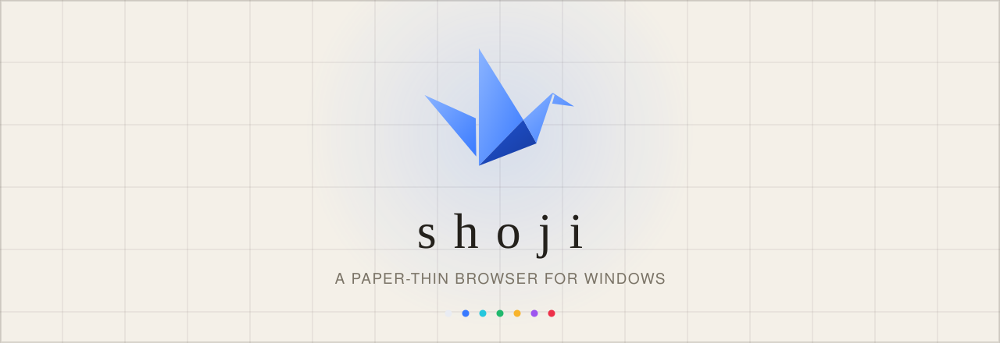
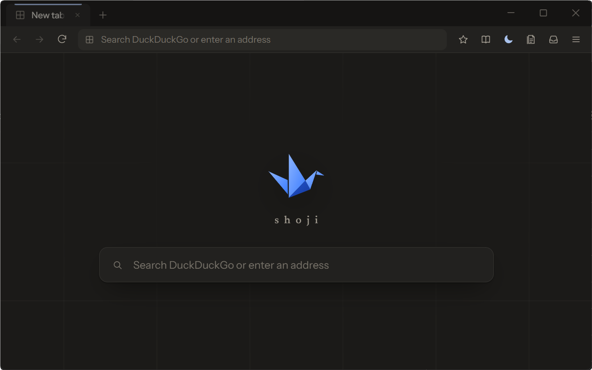
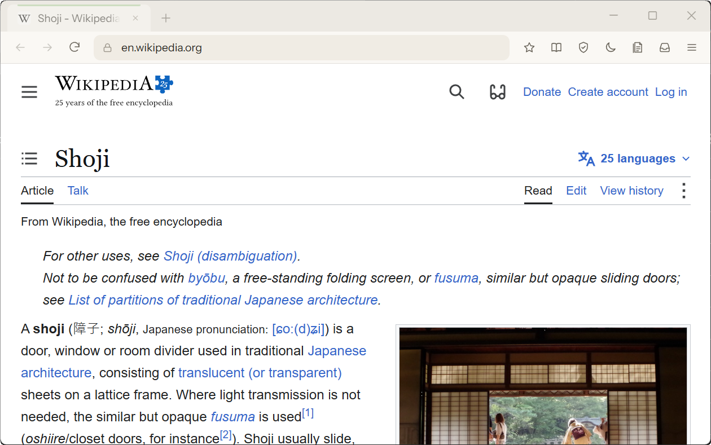

<div align="center">

<picture>
  <source media="(prefers-color-scheme: dark)" srcset="docs/assets/banner-dark.svg">
  
</picture>

<br>

[](../../releases/latest)

[](LICENSE)

**障子** · A browser that's mostly empty space.

[**Download**](../../releases/latest)

</div>

<br>

<p align="center">
  
  
</p>

## The idea

A *shoji* is the sliding paper screen of a Japanese room: a thin frame that lets light through
and keeps very little for itself. Shoji the browser works the same way. It doesn't ship a
browser engine. It uses the Microsoft Edge WebView2 runtime that Windows 10 and 11 already
install and patch, and adds only what a browser needs around it — tabs, an address bar, a
side panel, settings — drawn in a calm paper-and-ink interface.

## Almost nothing

- **~6 MB.** Fonts and ad blocker included.
- **No account, no sync, no telemetry.**
- **Ads and trackers gone** from the first launch, tracking links cleaned, Global Privacy Control on.
- **Dark mode for every website.**
- **Private mode** is one switch.
- A few small things aren't listed here. Have fun finding them.

## Install

Download **`ShojiSetup.exe`** from the [latest release](../../releases/latest). It installs for your
user only — no administrator prompt — and keeps itself up to date.

> Shoji isn't code-signed yet, so SmartScreen may say the app is unrecognized. Choose
> **More info → Run anyway**.

## Build

Windows 10/11 x64, the Rust MSVC toolchain and the Visual Studio C++ build tools.

```powershell
cargo run -p shoji               # run the browser
cargo test --workspace           # tests
.\scripts\build-installer.ps1    # dist\ShojiSetup.exe
```

How it fits together: [docs/architecture.md](docs/architecture.md).

## License

[MIT](LICENSE). Built on Microsoft WebView2, [Dark Reader](https://github.com/darkreader/darkreader),
Brave's [adblock-rust](https://github.com/brave/adblock-rust) and uBlock Origin's filter lists; see
[THIRD_PARTY_NOTICES.md](THIRD_PARTY_NOTICES.md).
